<p align="center">
  
</p>

<h1 align="center">RentMate</h1>

<p align="center"><strong>Bills, chores and repairs for your shared home, sorted.</strong></p>

<p align="center">
  <a href="https://github.com/ST10450618/RentMate/actions/workflows/android-ci.yml"></a>
  <a href="https://github.com/ST10450618/RentMate/actions/workflows/api-ci.yml"></a>
  
  
  
</p>

<p align="center">
  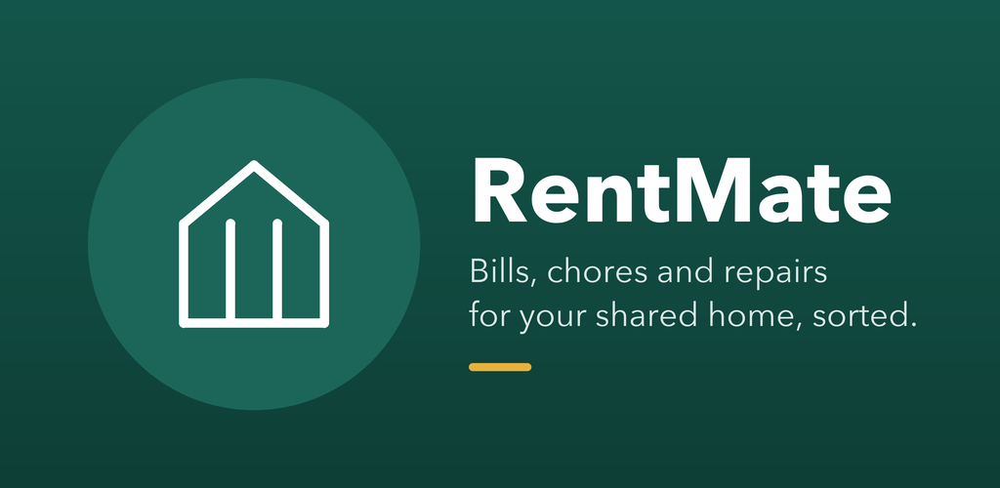
</p>

> **Technical report: Final Portfolio of Evidence**
> PROG7314 (Programming 3D), Emeris, 2026, Group 1: Michael Jani (ST10451592), Ruan Cupido (ST10450618), Seth Oliver (ST10434065, team lead) and Aliyu Yahaya Haliru (ST10440112).

---

## Abstract

People who share a home usually manage it across four unrelated tools: a chat group for chores, a banking app for rent, a note for the shopping list, and a message thread with the landlord that nobody can find again. RentMate brings all four into one native Android app.

The app is written in Kotlin with Jetpack Compose and follows MVVM. It is backed by Supabase (Postgres, PostgREST, Postgres functions and Supabase Auth), with Google Single Sign-On. The Final POE adds:
- biometric unlock
- offline mode with automatic sync
- real-time push notifications
- English, Afrikaans and isiXhosa
- photo attachments in blob storage
- an offline settle-up preview
- a household activity feed in a NoSQL database
- a signed, store-ready release build

This README is the project's technical report. It covers purpose, design considerations, architecture, the data model, DevOps, testing, Play Store readiness and the release notes since the prototype.

---

## Contents

1. [Demonstration video](#1-demonstration-video)
2. [Purpose and scope](#2-purpose-and-scope)
3. [Features](#3-features)
4. [Screenshots](#4-screenshots)
5. [Design considerations](#5-design-considerations)
6. [Architecture](#6-architecture)
7. [Data model](#7-data-model)
8. [Technology stack](#8-technology-stack)
9. [Getting started](#9-getting-started)
10. [Backend (Supabase)](#10-backend-supabase)
11. [Testing](#11-testing)
12. [DevOps: CI/CD and release management](#12-devops-cicd-and-release-management)
13. [Play Store readiness](#13-play-store-readiness)
14. [Part 2 feedback addressed](#14-part-2-feedback-addressed)
15. [Release notes](#15-release-notes)
16. [Team and collaboration](#16-team-and-collaboration)
17. [AI usage](#17-ai-usage)
18. [References](#18-references)

---

## 1. Demonstration video

**▶ Watch the demo: https://youtu.be/hNj_BwcDxGE** (unlisted)

[](https://youtu.be/hNj_BwcDxGE)

Recorded on a physical Android device with voice-over. It shows:

| Brief requirement | Where in the video |
|---|---|
| SSO registration and login with biometric verification | Opening section: sign-up with Google, creating and joining a household, app lock with fingerprint or PIN |
| Changing and saving settings | Settings section: notification switches, language picker |
| Real-time data round-trips with the cloud-hosted REST API | Money section: a new bill saved through the create_bill RPC |
| Going offline, acting, reconnecting and syncing | Offline section: airplane mode, queued changes, sync on reconnect |
| Live data changes in Supabase Auth, the API and the database | Supabase and Firebase sections: new user, bills, photo in Storage, Firestore events, push |
| Each user-defined feature | House section (4: photo attachments) and offline section (5: offline settle-up preview) |

## 2. Purpose and scope

The Part 1 research report compared Splitwise, Flatastic and Tricount. None covers RentMate's full scope:
- **Splitwise and Tricount** handle money but not chores.
- **Flatastic** handles household tasks but not the tenant's relationship with a landlord.
- **The maintenance request log** is RentMate's clearest differentiator; none of the three apps offers it.

The research also found two common complaints, which shape RentMate's design:
- **Unreliable notifications.** RentMate sends targeted pushes per event.
- **Patronising gamification.** RentMate's chore points are quiet, and the leaderboard can be hidden for the whole household.

**Target users:** students and young professionals in South African shared housing, often on limited mobile data, which is why the app works offline.

## 3. Features

Status key: ✅ done · 🔄 in progress · 📋 planned. This table is updated as each ticket closes.

### Mandatory features

| Feature | Story | Status |
|---|---|---|
| SSO registration and sign-in (Google via Supabase Auth) | US-1 | ✅ |
| Settings menu | US-3 | ✅ |
| REST API connected to a cloud database | US-5, US-6, US-9 | ✅ |
| REST API integrated into the app | — | ✅ |
| Biometric authentication | US-2 | ✅ |
| Offline mode with synchronisation (Room + WorkManager) | US-7 | ✅ |
| Real-time push notifications (Firebase Cloud Messaging) | US-8 | ✅ |
| Multi-language: English, Afrikaans, isiXhosa | US-4 | ✅ |
| Production assets: custom icon, splash, illustrations | — | ✅ |

### User-defined features

| # | Feature | Story | What it does | Status |
|---|---|---|---|---|
| 1 | **Maintenance request log** | US-10 | Log a fault with a category and urgency, send all open faults to the landlord as one itemised email, and track each request from open to sent, acknowledged and resolved. | ✅ (fixes ✅) |
| 2 | **Chore rotation and points** | US-9, US-12 | Shows the rotation four cycles ahead so everyone sees the same schedule. Points accrue quietly, and the leaderboard can be hidden for the whole household. | ✅ (fixes ✅) |
| 3 | **Settle-up** | US-11 | Debt simplification finds the smallest set of payments that clears the household. | ✅ |
| 4 | **Photo attachments** | US-10, US-6 | Photos of faults and receipts stored in Supabase Storage (blob storage) and shared with the household and landlord. | ✅ |
| 5 | **Offline settle-up preview** | US-11 | Runs the same debt simplification on the device's cached ledger, so housemates can see who owes whom without signal. | ✅ |

### Supporting features

| Feature | Status |
|---|---|
| Household activity feed stored in and read from Cloud Firestore (NoSQL) | ✅ |
| Inline validation on every form; invalid input can't crash the app | ✅ |
| Shared shopping list (US-13) | ✅ |

## 4. Screenshots

Captured on the physical test device (Samsung Galaxy Tab SM-X230) running the signed release build, at phone proportions (1080 × 2160). The household is demo data.

| Home | Money | Bill detail |
|---|---|---|
| 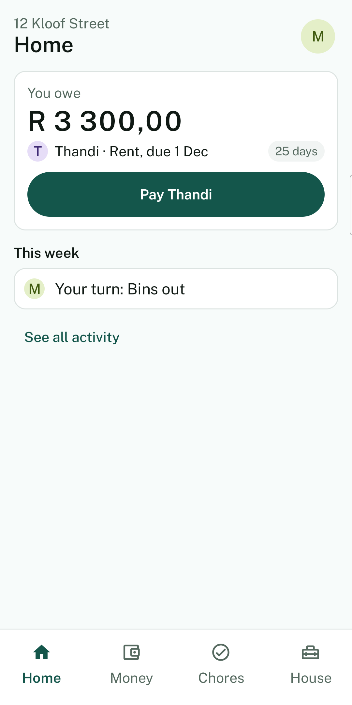 | 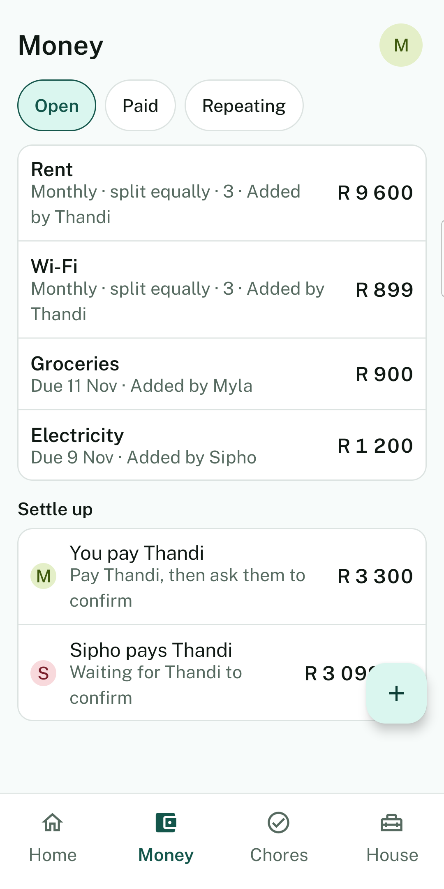 | 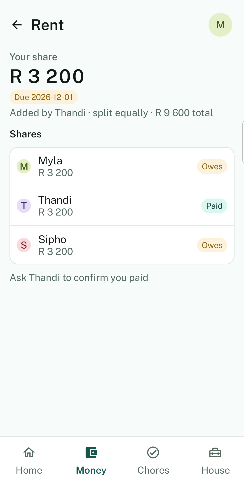 |

| Chores | Shopping | Repairs |
|---|---|---|
| 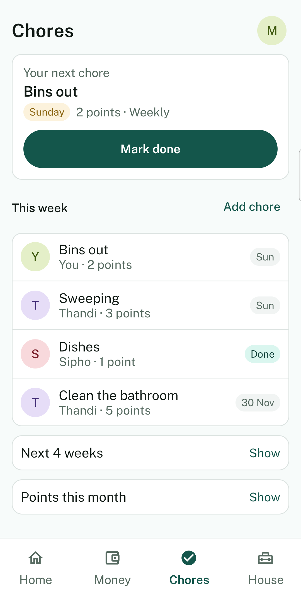 | 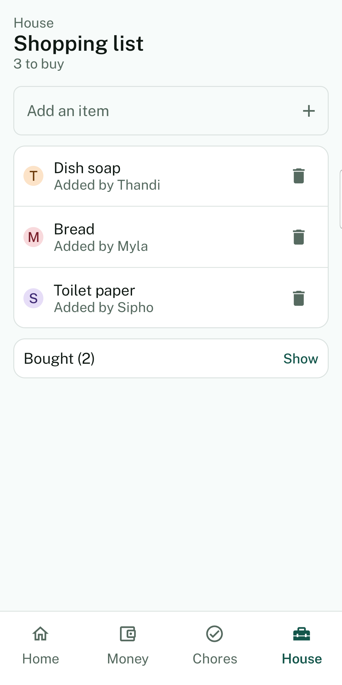 | 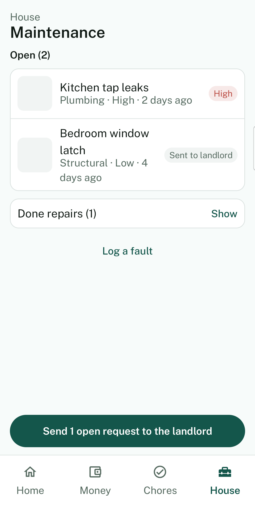 |

| Offline | Login | Settings |
|---|---|---|
| 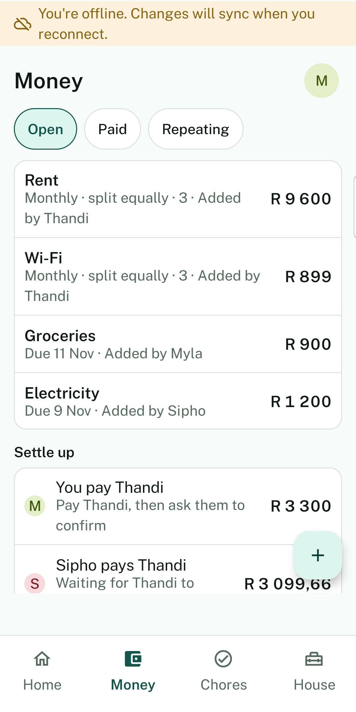 | 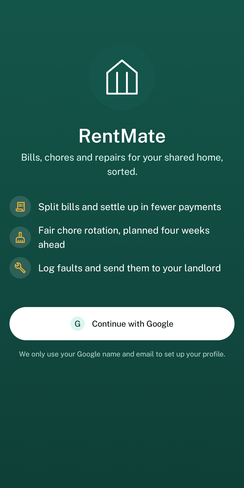 | 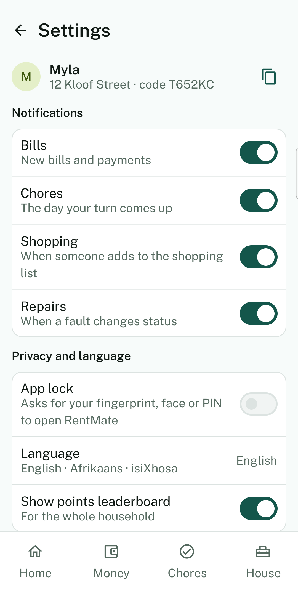 |

## 5. Design considerations

**Visual design system.** The palette comes from the Part 1 design document:
- **Aloe green** for navigation and confirmed states
- **Amber**, reserved for anything that needs a decision (an overdue bill, an unsent request, an unsynced change)
- **Clay** for errors
- **Sand** for the background

Every screen builds from shared components in `ui/components/RentMateComponents.kt`, so cards, buttons, status pills and avatars look the same everywhere. Typography, spacing (a 4 dp grid) and corner radii are tokens in `ui/theme/`. Dynamic colour is deliberately off, because the household palette is part of the brand.

**Error-tolerant input.** Every form validates inline as the user types, and again in the ViewModel before anything reaches the network (`ui/validation/FormValidation.kt`):
- amounts accept South African formats ("1 250,50", "R99.90")
- dates use a picker instead of free text
- amounts open a decimal keypad
- input length is capped

The validators are covered by unit tests, including a fuzz test that feeds them 5,000 random inputs.

**Friendly failure.** Raw exception text is never shown. Errors are written to Logcat for developers and shown to users as a short, translatable message.

**Navigation.** Four top-level destinations (Dashboard, Bills, Chores, More), within the three to five Material 3 recommends. Creation screens are modal and reached only from their parent list, so the back stack stays shallow.

**Server-side truth.** Anything housemates must agree on is computed once in Postgres, not separately on each phone: chore rotation, debt simplification and permission checks.

**Localisation.** All UI text lives in string resources with plural forms, translated into Afrikaans (`values-af`) and isiXhosa (`values-xh`), two official South African languages. The language is picked in Settings, where each language is shown in its own name. The switch applies at once through Android's per-app language support (`AppCompatDelegate.setApplicationLocales`), is kept after a restart, and is saved to the user's profile so it follows them to a new phone. `TranslationCompletenessTest` and lint's `MissingTranslation` check fail the build if a key is missing from either language.

### Translation accuracy

The Afrikaans (`values-af`) and isiXhosa (`values-xh`) translations are machine-translated. No first-language speaker has reviewed them.

Expect accuracy similar to Google Translate. Most screens read correctly, but some wording may be awkward, too literal or wrong, especially plurals and isiXhosa number forms. English (`values`) is the reference text.

The app says the same thing in Settings, under the language picker (`language_translation_disclaimer`), so users see it before they switch.

If you find a wrong translation, fix the string in `values-af` or `values-xh`. `TranslationCompletenessTest` checks that every English string still has an Afrikaans and an isiXhosa version.

**Privacy.** Data is scoped to a household by Row Level Security. Biometric data never leaves the device. See [PRIVACY.md](PRIVACY.md).

## 6. Architecture

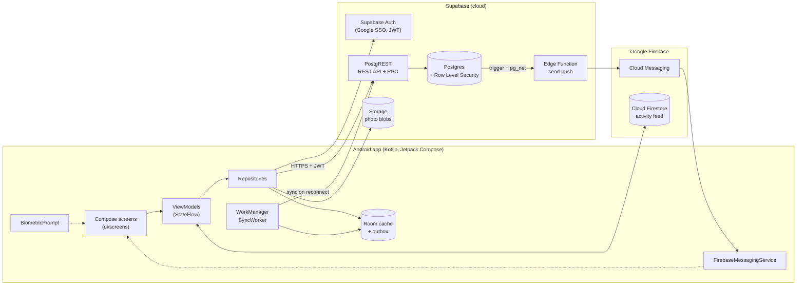

**MVVM.** Compose screens observe `StateFlow` from Hilt-injected ViewModels. ViewModels call repositories and never touch the UI.

**REST API.** PostgREST generates a REST API from the Postgres schema. Logic beyond plain create, read, update and delete runs in Postgres functions, called through the same API's `rpc()` endpoint:
- `create_household`
- `join_household`
- `complete_chore`
- `settle_up`
- `confirm_settlement`
- `send_to_landlord`

**Access control.** Row Level Security policies run inside Postgres against the JWT that Supabase Auth issues. A client can't read or write another household's data, whatever request it sends.

**Offline-first** (Final POE):
- Room is the local source of truth.
- Writes go to Room first and are queued in an outbox.
- A WorkManager worker, constrained to run only when the network is connected, replays the outbox in order when the connection returns.

**Why Supabase instead of Azure.** Part 1 specified ASP.NET Core on Azure App Service, but Azure for Students credit wasn't available to the team. The ASP.NET Core project remains in `RentMate.Api/` as the reference implementation. Its `DebtSimplificationService` and `ChoreRotationService` were ported unchanged into Postgres functions.

## 7. Data model

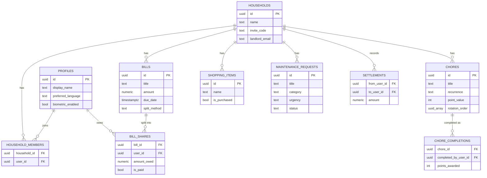

The schema is defined in `supabase/migrations/` as plain SQL, in numbered files.

## 8. Technology stack

| Layer | Choice |
|---|---|
| Language and UI | Kotlin, Jetpack Compose, Material 3 |
| Architecture | MVVM, Navigation Compose, Hilt dependency injection |
| Local storage | DataStore (settings), Room (offline cache and outbox) |
| Background work | WorkManager |
| Networking | supabase-kt (Postgrest, Auth, Storage), Ktor |
| Backend | Supabase: Postgres, PostgREST, Postgres functions, Edge Functions |
| Blob storage | Supabase Storage |
| NoSQL | Google Cloud Firestore |
| Authentication | Google SSO through Credential Manager and Supabase Auth; AndroidX Biometric |
| Push | Firebase Cloud Messaging (HTTP v1) |
| CI/CD | GitHub Actions |
| Testing | JUnit 4 (client), xUnit (reference API) |
| Project tracking | Ajiya (plan in `ajiya/`) |

## 9. Getting started

**Prerequisites:** Android Studio, JDK 17, an Android device running 8.0 or later with USB debugging on, and access to the Supabase project.

```bash
git clone https://github.com/ST10450618/RentMate.git
cd RentMate
```

Create `local.properties` in the project root. It is gitignored.

```properties
sdk.dir=/path/to/Android/sdk
SUPABASE_URL=https://<project-ref>.supabase.co
SUPABASE_ANON_KEY=<anon key from Supabase → Settings → API>
WEB_CLIENT_ID=<Google OAuth "Web application" client ID>.apps.googleusercontent.com
```

Build and install a debug build on a connected device:

```bash
./gradlew installDebug
```

Debug builds are signed with the shared `keystore/debug.keystore`, so the SHA-1 registered for Google Sign-In works on every machine.

`app/google-services.json` (Firebase project `rentmate-b120f`) is committed on purpose so every machine and CI can build. It holds only the project ID and an API key that ships inside every APK anyway. The Firebase service-account key used to send pushes is a secret: it lives only in Supabase Edge Function secrets and is never committed.

## 10. Backend (Supabase)

Schema, Row Level Security and functions are numbered SQL migrations in `supabase/migrations/`:

| Migration | Contents |
|---|---|
| `0001_init.sql` | Tables, indexes and Row Level Security policies |
| `0002_functions.sql` | `create_household`, `join_household`, `complete_chore`, `forecast_chore`, `settle_up`, `confirm_settlement`, `leaderboard` |
| `0003_send_to_landlord.sql` | Groups open maintenance requests into one request to the landlord |
| `0004`–`0006` | Members can read the household roster and each other's display names |
| `0012_deterministic_settle_up.sql` | `settle_up` gives the same payments every time it runs |
| `0013_lock_chores_households.sql` | Members can edit only the chore and household fields the app uses |
| `0014_recurring_bills.sql` | Weekly or monthly repeat on bills, `stop_bill_repeat`, and a daily `pg_cron` job that copies due bills once |

The repo is linked to the hosted project with the Supabase CLI:

```bash
supabase login
supabase link --project-ref crmomoazxwrdsicfphav
supabase migration list        # compare local and remote history
supabase db push               # apply new migrations
```

Edge Function secrets (set with `supabase secrets set`, never committed):

| Secret | Used for |
|---|---|
| `FIREBASE_SERVICE_ACCOUNT` | Firebase service-account JSON, so the push Edge Function can call FCM HTTP v1 |
| `FIREBASE_PROJECT_ID` | `rentmate-b120f` |

## 11. Testing

```bash
./gradlew testDebugUnitTest    # client unit tests
./gradlew lintDebug            # Android Lint
cd RentMate.Api && dotnet test # reference API tests
```

| Test class | Covers |
|---|---|
| `FormValidationTest` | Every input rule, plus a 5,000-input fuzz test that no validator throws |
| `MaintenanceRequestTest` | Maintenance status transitions and title validation |
| `AppLanguageTest` | Language selection mapping, including locale list to language |
| `TranslationCompletenessTest` | Every translatable key is in `values-af` and `values-xh`, with the same format arguments |
| `RentMate.Api.Tests` | Debt simplification and chore rotation algorithms (reference implementation) |

Every feature is also checked on a physical device against its ticket's "Done when" check in `ajiya/`.

## 12. DevOps: CI/CD and release management

### Continuous integration

`.github/workflows/android-ci.yml` runs on **every push to every branch** and on pull requests into `main` and `develop`. It:
1. checks out the code and sets up JDK 17 with Gradle caching
2. runs Android Lint
3. runs the unit test suite
4. assembles the APK
5. uploads test and lint reports as artefacts, even when the job fails

`api-ci.yml` builds and tests the reference ASP.NET Core API. Both workflows cancel a stale run when a newer push arrives on the same branch.

### Release builds

| Item | Setup |
|---|---|
| Signing | Release builds use an upload keystore read from the gitignored `keystore.properties` locally, or from `RENTMATE_KEYSTORE_*` environment variables (GitHub secrets) in CI. The keystore is never committed. |
| Shrinking | R8 minification and resource shrinking are on. Keep rules in `app/proguard-rules.pro` cover kotlinx.serialization, Supabase, Ktor and Credential Manager. The release APK is 3.5 MB, down from 23.7 MB for debug. |
| Versioning | `versionCode 2`, `versionName 1.0.0` (`1` was the Part 2 prototype) |
| Artefacts | `./gradlew assembleRelease` builds the signed APK; `./gradlew bundleRelease` builds the AAB for Google Play |

#### Releasing from CI

`.github/workflows/android-release.yml` runs when a tag matching `v*` or `final-poe` is pushed (or by hand from the Actions tab). It builds the signed APK and AAB, checks the APK signature with `apksigner`, and uploads the APK, the AAB and the R8 `mapping.txt` as artefacts named after the tag. It fails at once, with a clear message, if a signing secret is empty.

Add these repository secrets under Settings, Secrets and variables, Actions:

| Secret | Value |
|---|---|
| `RENTMATE_KEYSTORE_BASE64` | The upload keystore, base64 encoded |
| `RENTMATE_KEYSTORE_PASSWORD` | Keystore password |
| `RENTMATE_KEY_ALIAS` | Key alias |
| `RENTMATE_KEY_PASSWORD` | Key password |

`SUPABASE_URL`, `SUPABASE_ANON_KEY` and `WEB_CLIENT_ID` are optional secrets. The workflow writes them to `local.properties` when set, so the release build can reach the backend.

Encode the keystore on macOS with `base64 -i upload.jks | pbcopy`, then paste it into the secret. To cut a release:

```
git tag v1.0.0
git push origin v1.0.0
```

### Version control workflow

- `main` is the submitted state.
- `fix/post-part2-feedback` is the integration branch for the Final POE.
- Each member works on their own branch and merges through pull requests reviewed by another member.
- Commits follow Conventional Commits and end with an `Ajiya: RM-xxxx` trailer linking them to a ticket in the plan.
- The final deployment commit is tagged **`final-poe`**; the prototype is tagged `part-2`.

### Project tracking

The plan is tracked with Ajiya in `ajiya/`: 46 tickets across 10 phases, each with a verifiable "Done when" check, its dependencies and its owner. `docs/WORK_SPLIT_FINAL_POE.md` gives the per-member order of work.

## 13. Play Store readiness

Everything needed to publish is in [`docs/store/`](docs/store/):

| Requirement | Location |
|---|---|
| Signed production APK | [`release/RentMate-1.0.0.apk`](release/RentMate-1.0.0.apk): version 1.0.0 (versionCode 2), signed with the RentMate upload key and built with R8. Install on Android 8.0 or later. Pushing a tag also builds the APK and AAB in CI and publishes them as a GitHub Release. Locally: `./gradlew assembleRelease bundleRelease` |
| 512 × 512 hi-res icon | `docs/store/icon-512.png` |
| 1024 × 500 feature graphic | `docs/store/feature-graphic-1024x500.png` |
| Phone screenshots (8 for upload, 1 extra) | [`docs/store/screenshots/`](docs/store/screenshots/), shown in section 4 |
| Title, short and full description | `docs/store/listing.md` |
| Content rating, data safety and app-access answers | `docs/store/listing.md` |
| Privacy policy | [PRIVACY.md](PRIVACY.md) |

## 14. Part 2 feedback addressed

| Lecturer feedback (Part 2) | Fix | Ticket | Status |
|---|---|---|---|
| Network failure on Maintenance crashes the app | Errors caught in every ViewModel; friendly error states | RM-0001 | ✅ |
| Back on Dashboard loops between Login and Dashboard | Login removed from the back stack after sign-in | RM-0003 | ✅ |
| Users must sign in on every launch | Session restored from storage on launch | RM-0002 | ✅ |
| Raw error messages shown | Exceptions mapped to translatable messages; Login already fixed | RM-0004, RM-0034 | ✅ |
| Settings saved but never read back | Settings loaded from the server on sign-in | RM-0005 | ✅ |
| Access rules too loose (join without code, edit any bill) | Joining only through the invite-code RPC; bill edits restricted to the creator | RM-0006 | ✅ |
| Chore forecast function never used | App uses the server forecast | RM-0007 | ✅ |
| Leaderboard can be farmed; hide only saved on device | Only the assignee completes, once per cycle; hide stored for the whole household | RM-0008 | ✅ |
| "Send to landlord" sends nothing; anyone can change status | Itemised email to the landlord; only the sender records replies | RM-0009 | ✅ |
| Debtor confirms own payment; only equal splits | Creditor confirms; equal, percentage and exact splits | RM-0010 | ✅ |
| Amounts don't open a number keypad | Decimal keypad on amount fields, number keypad on points | RM-0036 | ✅ |
| Raw user IDs on screen | Display names everywhere, with "Housemate" as the fallback | RM-0011, RM-0034 | ✅ |
| Login is one line of text; screens bare | Branded Login, design system, shared components | RM-0034 | ✅ |
| Automated tests not working | CI fixed and shown passing | RM-0012 | ✅ |

## 15. Release notes

### 1.0.0: Final POE

`versionName 1.0.0`, `versionCode 2`. These are the changes since the Part 2 prototype (0.x, versionCode 1). Ticket IDs refer to the Ajiya plan in `ajiya/`.

**Added**
- **Biometric unlock.** After Google sign-in the app asks for a fingerprint, face or the device PIN, and locks again after a minute in the background. You can turn it off in Settings. Phones without biometrics fall back to the PIN or show an explanation (RM-0013, RM-0014).
- **Stay signed in.** The Supabase session is saved, so reopening the app goes straight to the Dashboard (RM-0002).
- **Offline reading.** Bills, chores, shopping items and the Dashboard come from a local Room database and refresh from Supabase. In airplane mode the app shows the cached data with an offline message instead of an empty screen (RM-0015, RM-0016).
- **Offline writes and sync.** A shopping item, a bought item or a bill added offline is saved locally with a "Waiting to sync" badge (RM-0017). A WorkManager job uploads the queue when the network is back, in the order the changes were made, and the badges clear once the server has them (RM-0018).
- **Push notifications.** Firebase Cloud Messaging with separate channels for bills, chores and repairs. A Supabase Edge Function sends a push for a new bill, a chore that is due and a repair status change. Tapping a push opens Bills, Chores or Maintenance, and each type can be turned off in Settings (RM-0020 to RM-0023).
- **Activity feed.** Household events are written to Firestore, and the Activity screen shows them live. Firestore security rules keep other households out (RM-0032, RM-0033).
- **Photo attachments.** Add photos to bills and maintenance requests from the camera or the gallery. Photos are compressed to under 1 MB, upload with a progress bar and offer Retry on failure. They are stored in a household-only Supabase Storage bucket and linked in the landlord email (RM-0027 to RM-0029).
- **Three languages.** Every string is in English, Afrikaans and isiXhosa, with an in-app language picker that survives a restart. The Afrikaans and isiXhosa text is machine-translated and Settings says so (RM-0024 to RM-0026).
- **Split options.** Bills split equally, by percentage or by exact amounts. The server rejects splits that do not add up (RM-0010).
- **Recurring bills.** A bill can repeat weekly or monthly. A daily `pg_cron` job creates the next copy once per cycle, and only the person who added it can stop it (RM-0049).
- **Send to landlord.** Builds an itemised email of open faults with photo links. Only the housemate who sent it can record the landlord's reply (RM-0009).
- **Offline banner.** One banner above every signed-in screen says when you are offline, how many changes are waiting, and when they have synced. A change the server refuses is explained once (RM-0019).
- **Offline settle-up preview (user-defined feature 5).** Offline, Money works out who owes whom from the cached ledger, including bills added offline, and labels it as a preview. Confirming a payment waits for the server (RM-0031).
- **Snackbar feedback.** Every failed action shows a clear message, with Retry when trying again can help. A Settings toggle that fails to save flips back (RM-0052).
- **Design system and redesign.** Shared colour, type, spacing and size tokens; shared buttons, cards, pills, headers and avatar colours; one 16 dp screen gutter; empty, loading and error states on every list; a branded Login, adaptive icon and splash screen (RM-0034 to RM-0037, RM-0050 to RM-0054).
- **UI redesign.** Every screen follows `docs/ui-redesign-plan.html`: four tabs (Home, Money, Chores, House) with outline and filled icons, Settings on your avatar, titles on the page instead of a green banner, Public Sans, amounts as R 1 245,00, rows instead of cards, one main button per screen, Undo for 5 seconds instead of confirm dialogs, two columns on tablets, and support for the largest font size and TalkBack. Home leads with what you owe; Money puts bills and settle-up on one screen with a bill detail view; household setup asks one thing at a time (RM-0056 to RM-0061).
- **Release build.** Signed with secrets from CI, R8 enabled, and CI builds the signed APK when a tag is pushed (RM-0039, RM-0040).
- **Play Store pack.** Hi-res icon, feature graphic, listing text, data safety answers and the privacy policy (RM-0041, screenshots still to come).
- Supabase CLI configuration for the hosted project, with the SQL migrations and tests in `supabase/`.

**Changed**
- Settings now load from the server on sign-in, so they follow you to another phone (RM-0005).
- The chore forecast comes from the server (`forecast_chore`) instead of being worked out on the phone (RM-0007).
- Settle-up uses one debt-simplification algorithm, written in Kotlin and tested against the server's `settle_up` results (RM-0030).
- Amount fields open a number keypad, raw user IDs never show, and every amount limit reads from one place: R999,999.99 (RM-0011, RM-0053).
- All forms validate inline with translated messages (RM-0036).
- Due dates use a date picker, and money shows consistently as South African rand.
- Bills show paid and outstanding pills and housemate avatars.

**Fixed**
- The app no longer crashes offline. Every network error shows a friendly, translated message instead of raw exception text (RM-0001, RM-0004).
- Back on the Dashboard closes the app instead of returning to Login (RM-0003).
- CI runs the Android and API tests on every push again (RM-0012).
- Housemates' names no longer show as blank in settle-up (Part 2 follow-up).
- Sign out works and clears the cached household data.

**Security**
- Row-level security rules were tightened. A household can only be joined with its invite code, only the creator of a bill can edit or delete it, and shares are marked paid only through an RPC (RM-0006).
- Only the person assigned a chore can complete it, points count once per cycle, and the leaderboard setting applies to the whole household (RM-0008).
- Members cannot edit chore rotation, points or the invite code directly. These change only through server functions (RM-0048).
- Only the creditor can confirm a settle-up payment (RM-0010).

**Tested on a device**
- Every device check in RM-0047 passed on a Samsung Galaxy Tab (SM-X230) with the signed release build on 6 November 2026.

### 0.x: Part 2 prototype

SSO sign-in, household setup with invite codes, bills with equal splits, chore rotation with points, the shared shopping list, the maintenance request log, settle-up, Settings, and the Supabase REST API.

## 16. Team and collaboration

| Member | Final POE responsibilities |
|---|---|
| **Michael** | Crash and session fixes, biometric unlock, offline mode with sync, offline settle-up preview |
| **Seth** | Database access rules, CI, server-side chore and settle-up rules, Firebase, Firestore, the push Edge Function |
| **James** | Settings sync, landlord email, multi-language, photo attachments |
| **Ali** | Design system and UI, form validation, production assets, notification client, activity feed screen, release, documentation |

The full split and order of work are in [`docs/WORK_SPLIT_FINAL_POE.md`](docs/WORK_SPLIT_FINAL_POE.md). Branch and commit conventions are in [CONTRIBUTING.md](CONTRIBUTING.md).

## 17. AI usage

See [`AI_USAGE.md`](AI_USAGE.md) for a transparent summary (maximum 500 words) of how generative AI tools were used and cited for code generation, bug fixing and asset generation, and how the team verified their output.

## 18. References

1. Android Developers (2025) _Build an offline-first app_. Available at: https://developer.android.com/topic/architecture/data-layer/offline-first
2. Android Developers (2025) _Show a biometric authentication dialog_. Available at: https://developer.android.com/identity/sign-in/biometric-auth
3. Android Developers (2025) _Splash screens_. Available at: https://developer.android.com/develop/ui/views/launch/splash-screen
4. Android Developers (2025) _Schedule tasks with WorkManager_. Available at: https://developer.android.com/topic/libraries/architecture/workmanager
5. Android Developers (2025) _Shrink, obfuscate, and optimize your app_. Available at: https://developer.android.com/build/shrink-code
6. Android Developers (2025) _Per-app language preferences_. Available at: https://developer.android.com/guide/topics/resources/app-languages
7. Firebase (2025) _Firebase Cloud Messaging_. Available at: https://firebase.google.com/docs/cloud-messaging
8. Firebase (2025) _Cloud Firestore_. Available at: https://firebase.google.com/docs/firestore
9. Google (2025) _Material Design 3_. Available at: https://m3.material.io/
10. Google Play (2025) _Prepare your app for review_. Available at: https://support.google.com/googleplay/android-developer/answer/9859455
11. Supabase (2025) _Supabase documentation_. Available at: https://supabase.com/docs
12. Jones, M., Bradley, J. and Sakimura, N. (2015) _JSON Web Token (JWT)_, RFC 7519. IETF. Available at: https://datatracker.ietf.org/doc/html/rfc7519
